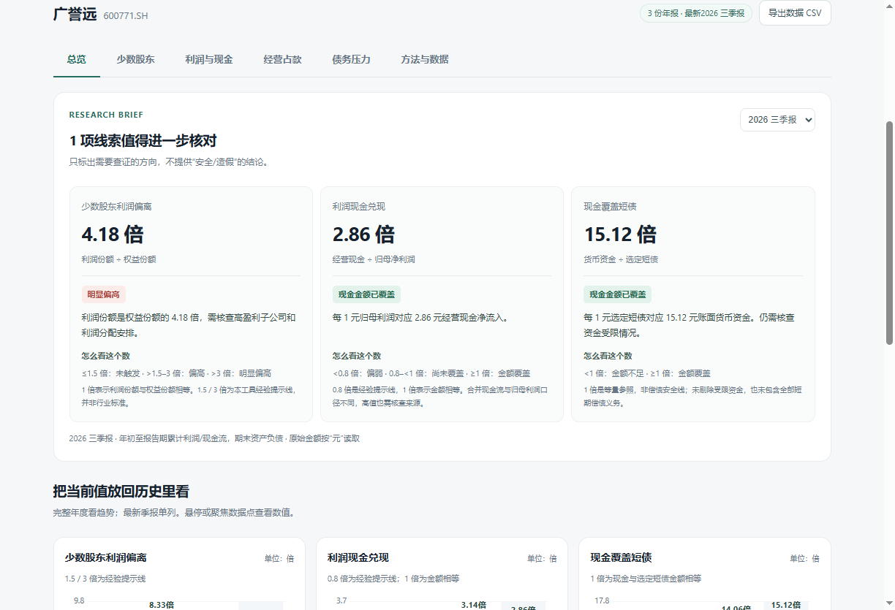

# FinScope · 财务透镜

[](https://github.com/freesaber/FinScope/actions/workflows/release.yml)
[](LICENSE)

面向 A 股上市公司的开源财报分析客户端。输入股票代码，即可查看近三年年报与最新季报，了解利润归属、现金兑现、经营占款和债务压力。

无需登录，无需配置 API Key。



## 主要功能

- 六个分析模块，提供原始数据、计算公式、参考区间与趋势图。
- 查询记录按“推荐、保留意见、不推荐”分类，支持删除和拖动排序。
- 本地缓存与离线读取，支持导出 CSV。

## 下载安装

前往 [Releases](https://github.com/freesaber/FinScope/releases/latest)，下载 Windows x64 安装包，按向导安装。

支持 Windows 10 / 11，无需额外安装运行环境。更新时先退出旧版，再安装新版，原有查询记录会保留。安装包未进行商业代码签名，Windows 可能提示发布者未知。

## 本地运行

需要 Node.js 22（≥22.12）。

```powershell
git clone https://github.com/freesaber/FinScope.git
cd FinScope
npm ci
npm start
```

```powershell
npm test                 # 运行测试
npm run test:desktop     # 桌面功能验证
npm run dist             # 构建 Windows 安装包
```

## 数据与许可

数据来自东方财富公开网页接口，可能受接口变更或访问限制影响，请以公司最新公告为准。本工具仅供财务研究，分类与提示不构成投资建议。

采用 [MIT License](LICENSE)。版本更新内容见 [发布说明](https://github.com/freesaber/FinScope/releases)。
