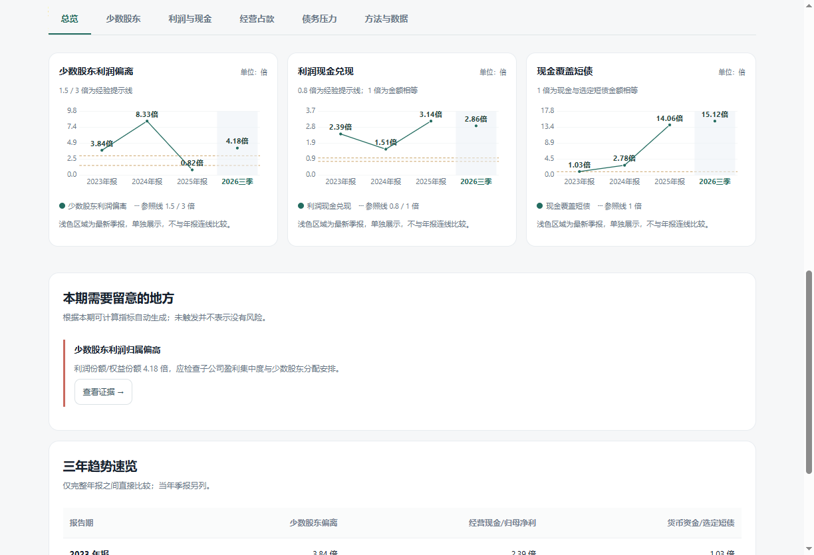

# FinScope · 财务透镜

[](https://github.com/freesaber/FinScope/actions/workflows/release.yml)
[](LICENSE)

**面向 A 股上市公司的开源财报分析客户端。**

FinScope 从利润归属、现金兑现、经营占款和近期债务四个角度，帮助研究者发现值得进一步核查的财务线索。每项分析提供计算公式、历史数据、适用边界与后续核查方向，方便回到公司公告验证。

无需登录，无需配置 API Key。当前发布 Windows x64 桌面安装包。


v0.2.0 增加参考区间、状态标签、白话解读与趋势图。倍数统一显示为“倍”；每个指标卡解释当前值，并说明参照值的性质。



## 下载与安装

前往 **[Releases 下载页面](https://github.com/freesaber/FinScope/releases/latest)**，下载 `FinScope-Setup-版本号-x64.exe`，按向导安装。支持选择安装目录和创建桌面快捷方式，默认按当前用户安装。

- 运行环境：Windows 10 / 11，64 位；无需另装 Node.js 或 Python。
- 首次查询需要联网；成功查询后可在断网时手动读取本地缓存。
- 发布页附有 `SHA256SUMS.txt`。可用 `Get-FileHash .\FinScope-Setup-0.1.0-x64.exe -Algorithm SHA256` 核对。
- 当前安装包未进行商业代码签名，Windows 可能显示发布者未知，请核对下载来源与 SHA-256。

## 分析模块

| 模块 | 研究问题 | 提供的证据 |
| --- | --- | --- |
| 总览 | 哪些信号值得优先核查？ | 指标摘要、触发原因、三年趋势、证据页跳转 |
| 少数股东 | 利润份额是否明显高于权益份额？ | 权益份额、利润份额、偏离倍数及原始数据 |
| 利润与现金 | 盈利是否伴随经营现金流入？ | 经营现金流、归母净利润及历年兑现比 |
| 经营占款 | 应收、存货是否比收入增长更快？ | 完整年度的收入、应收与存货增速比较 |
| 债务压力 | 货币资金能否覆盖选定短期债务？ | 短期借款、一年内到期非流动负债及覆盖倍数 |
| 方法与数据 | 数字从哪里来，计算是否可信？ | 口径说明、字段映射、缺失项提示、原始 JSON |

同时支持报告期切换、最近查询、离线缓存读取和 CSV 导出。CSV 使用 UTF-8 BOM，金额单位为元；比值以小数导出，缺失数据留空。

## 使用流程

1. 输入六位 A 股代码，例如 `600519`、`300750`；也可输入 `600519.SH`。
2. 点击“分析财报”，等待三张合并报表获取完成。
3. 在总览查看线索，切换报告期与具体模块，核对公式和原始数据。
4. 点击“导出数据 CSV”，选择文件保存位置。

查询失败时，当前查询结果会清空；如果该股票曾成功查询，可点击“读取本地缓存”。界面始终标注原始获取时间，缓存不会冒充最新数据。最近查询按钮会重新联网查询。

## 数据来源与计算纪律

数据来自[东方财富财务分析公开网页](https://emweb.securities.eastmoney.com/PC_HSF10/NewFinanceAnalysis/Index?type=web&code=sh600519)使用的网页接口。本项目与东方财富无合作关系，这些接口不属于具有服务承诺的正式开放 API。

- **完整报表**：数据中心摘要接口只用于发现报告期；指标计算使用 F10 资产负债表、利润表及现金流量表，`reportType=1`，合并口径。摘要接口缺少少数股东等关键字段，不能直接用于相应计算。
- **年度选择**：最近三份已披露的 12 月 31 日年报；更新年份的最新季报另列。上市历史较短的公司可能不足三份年报。
- **期间区别**：利润与现金流为年初至报告期累计值，资产负债为期末余额。季报不年化，经营占款模块不把季报累计收入与全年收入直接横比。
- **修订处理**：同一报告期返回多条记录时，优先取公告日期较新的记录；仍应以公司最新公告原文为准。
- **缺失处理**：不补零、不生成模拟数值；分母为零、利润为负等不适用情形显示 `—`。现金流接口单独失败时，保留其余报表并提示缺失。
- **金融企业**：根据源站报表类型识别，经营占款与债务模块暂停普通企业初筛；其他模块亦应结合行业口径理解。

### 核心公式

| 指标 | 计算方式 | 解释边界 |
| --- | --- | --- |
| 少数股东权益份额 | 少数股东权益 ÷ 所有者权益合计 | 期末净资产结构 |
| 少数股东利润份额 | 少数股东损益 ÷ 合并净利润 | 累计利润归属结构 |
| 份额偏离倍数 | 利润份额 ÷ 权益份额 | 不能据此推定明股实债 |
| 现金兑现比 | 经营活动现金流净额 ÷ 归母净利润 | 合并现金流与归母利润范围不同，是筛查代理指标 |
| 应收、存货、收入增速 | 本年值 ÷ 上年值 − 1 | 仅在正基数、完整年度条件下比较 |
| 选定短债 | 短期借款 + 一年内到期非流动负债 | 未覆盖全部短期偿债义务 |
| 现金覆盖倍数 | 货币资金 ÷ 选定短债 | 未剔除受限资金，不等于实际偿债能力 |

偏离倍数 1.5× / 3×、现金兑现比 0.8×、增速差 20 个百分点、现金覆盖倍数 1× 等阈值，仅用于生成研究提示，不是会计准则或监管认定标准。未触发信号不代表公司没有风险。

图表保留真实正负值，缺失点断线，不补为零；季报单独展示，不连接到年度趋势。利润与现金、现金与短债使用完整年度并排柱状图，经营占款比较年度增速。悬停或键盘聚焦数据点可查看数值。

1 倍仅表示分子和分母金额或份额相等；1.5 / 3 倍、0.8 倍和 20 个百分点为本工具的经验提示线。没有接入同行业分位数，因此不提供“行业合理区间”。行业间财务比率差异的基本解释可参考 [SEC 财务报表入门指南](https://www.sec.gov/investor/pubs/begfinstmtguide.htm)，该资料不为本工具的经验阈值背书。

## 本地开发

需要 Node.js 22（≥22.12）和 npm；构建 Windows 安装包建议在 Windows 环境执行。

```powershell
git clone https://github.com/freesaber/FinScope.git
cd FinScope
npm ci
npm start
```

```powershell
npm test                 # 数据校验、计算边界、报告期与修订选择
npm run test:desktop     # 验证真实 Electron 预加载、隔离、六个模块与报告期切换
npm run check:live       # 使用 600519 验证在线完整报表
npm run dist             # 生成 dist/ 下的 Windows NSIS 安装包
```

桌面自动化测试使用明确标识的测试数据，避免持续集成依赖第三方接口。在线接口检查单独执行；联网桌面验证可用 `npm run test:desktop -- --live`。测试截图写入 `test-results/`，不纳入发布包。

### 项目结构

```text
electron/       主进程、受限预加载桥接、公开数据适配
src/            六个分析模块、计算与渲染、样式
assets/         应用图标
tests/          数据适配与分析边界测试
scripts/        桌面验证与真实接口检查
.github/        GitHub Actions 构建和发布流程
docs/           界面截图与发布说明
```

页面采用 Electron 沙箱、上下文隔离与内容安全策略，未开放 Node.js、任意网络请求或任意文件读写。网络请求固定访问东方财富接口，CSV 保存由用户选择路径。安全设计参考 [Electron 官方安全指南](https://www.electronjs.org/docs/latest/tutorial/security/)。

## GitHub 构建与发布

推送 `main` 或提交 Pull Request 会运行测试并生成 Windows 构建产物，可在 [Actions](https://github.com/freesaber/FinScope/actions) 下载。推送与 `package.json` 版本一致的 `v*` 标签，会在构建成功后创建 GitHub Release，附上安装包和 SHA-256 校验文件。

```powershell
# 先修改 package.json 版本并同步锁文件，更新发布说明，再提交
git tag v0.1.0
git push origin v0.1.0
```

普通构建仅授予仓库读取权限，发布任务单独授予 `contents: write`，使用 GitHub 自带临时令牌，无需提交个人访问令牌。

## 隐私与限制

客户端没有注册、交易、遥测或数据上传功能。股票代码会随查询请求发送到东方财富；财报缓存和最近查询保存在 Electron 用户数据目录，Windows 默认为 `%APPDATA%\finscope\reports`。卸载保留缓存，可自行删除该目录。

当前版本聚焦单家公司分析，暂不支持全市场批量筛选、港美股、PDF 附注解析和自动更新。接口限流、字段变化、公告更正或网络故障可能影响结果。

本工具仅供财务研究与学习，不构成投资建议，也不对公司是否违规或财务造假作出判断。任何结论均应结合审计意见、财报附注、公司公告与行业背景独立核实。

## 开源许可

采用 [MIT License](LICENSE)。欢迎提交 Issue 或 Pull Request；计算口径修改请附公式依据、可复现样例和验证说明。代码许可不授予第三方数据的再分发权，使用数据时请遵守数据提供方条款。
